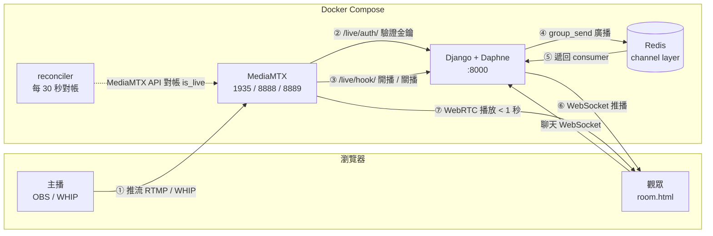

# docker-django-chat-room use django-channels 4💬 搭配 MediaMTX 直播

[](https://www.python.org/)
[](https://www.djangoproject.com/)
[](https://github.com/django/channels)
[](https://github.com/bluenviron/mediamtx)
[](https://redis.io/)
[](https://www.docker.com/)

* [Youtube Tutorial - chat-room use django-channels2](https://youtu.be/CoVdpZLCIT4)

## 前言

這篇文章是 [django-channels2-tutorial](https://github.com/twtrubiks/django-channels2-tutorial) 的改良版，主要加上美化以及資料庫，

又整合了 [MediaMTX](https://github.com/bluenviron/mediamtx)，讓聊天室進化成**直播間**（畫面 + 即時聊天）。

為什麼是這個組合？因為直播的價值在於「即時互動」，而互動需要**低延遲**。

傳統 HLS 延遲 10-30 秒（本專案 MediaMTX 預設走 Low-Latency HLS，約 2-5 秒），

觀眾的留言仍容易對不上主播當下在講什麼；

WebRTC 延遲 < 1 秒，彈幕才有意義。

已經有 Channels 的即時訊息基礎，MediaMTX 提供 < 1 秒的 WebRTC 影像，兩者各司其職、耦合度低：

* **MediaMTX** 負責影像（推流、播放）
* **Django + Channels** 負責聊天、身分、房間狀態

## 執行畫面

直接瀏覽 [http://localhost:8000/chat/](http://localhost:8000/chat/)


未登入無法聊天（ 也無法看到聊天內容，也無法觀看直播 ）


直播畫面


聊天畫面


分享位置（使用 [Leaflet](https://leafletjs.com/) 搭配 [OpenStreetMap](https://www.openstreetmap.org/) 圖資）


## 如何執行

確認電腦有安裝 docker 後，直接執行以下指令即可，

```cmd
docker compose up
```


會啟動四個服務：

| 服務 | 說明 |
|------|------|
| `app` | Django + Daphne（`:8000`） |
| `redis` | Channels channel layer（`:6379`） |
| `mediamtx` | 串流伺服器（RTMP `:1935`、HLS `:8888`、WebRTC / WHIP `:8889`、ICE `:8189/udp`） |
| `reconciler` | 每 30 秒對帳 `Room.is_live` 與 MediaMTX 實際狀態 |

如何移除 ( 包含移除 volume )，

```cmd
docker compose down -v
```

詳細說明，在上一篇 [django-channels2-tutorial](https://github.com/twtrubiks/django-channels2-tutorial) 都說明過了。

## 直播間

### 架構



### 低侵入設計

`Room` model 是**選用**的，房名與 MediaMTX 的 stream path 一對一對應：

```python
class Room(models.Model):
    name = models.SlugField(max_length=64, unique=True, ...)  # = MediaMTX path
    owner = models.ForeignKey(User, related_name='rooms', ...)
    stream_key = models.CharField(max_length=64, default=generate_stream_key)
    is_live = models.BooleanField(default=False)
    created = models.DateTimeField(auto_now_add=True)
```

**沒有註冊 `Room` 的房名，維持原本純聊天室的行為**（自由進入、沒有直播區塊）。

因此 `Message.group_name` 完全不用動，可以聚焦在直播功能本身。

`name` 用 `SlugField` 而非 `TextField`，因為它會直接變成 MediaMTX 的 path 與 URL 的一部分，必須限制字元；

另外用 `RegexValidator(r'^\w+$')` 排除 slug 預設允許的 `-`，以相容 WebSocket routing 的正則

### 開設直播間

登入後從首頁點「開設直播間」，或直接開 [http://localhost:8000/chat/create/](http://localhost:8000/chat/create/)。

建立後你就是房主，每人最多 5 個（`settings.MAX_LIVE_ROOMS_PER_USER`）。

首頁會列出所有直播間（直播中優先、每頁 12 筆）。

房主在自己的房間會多看到一塊「推流資訊面板」（非房主看不到），可以：

* 取得 OBS 伺服器位址與串流金鑰
* 一鍵用瀏覽器推流（WHIP）
* **重新產生金鑰**（金鑰外洩時自行輪替，舊金鑰下次推流即失效）
* **刪除直播間**（聊天記錄會一併刪除，見下方安全性說明）

### 開始推流

方法一，**OBS**：

* 伺服器：`rtmp://localhost:1935`
* 串流金鑰：`房名?user=你的帳號&pass=你的串流金鑰`

方法二，**瀏覽器（WHIP）**：直接點推流資訊面板的「用瀏覽器開始直播」。

觀眾端預設用 WebRTC（低延遲）播放，可切換 HLS（相容性較好）。主播開播 / 關播時，聊天室會即時跳出通知並自動載入 / 卸載播放器。

### 認證設計

**推流認證**走 MediaMTX 的 `authHTTPAddress`，把認證委派給 Django，不需要寫任何 MediaMTX plugin：

```yaml
# mediamtx.yml
authMethod: http
authHTTPAddress: http://app:8000/live/auth/
```

每次有人要推流或播放，MediaMTX 就 POST 一包 JSON 過來，**Django 回 20x 放行、其他拒絕**。

**觀看直播也需要登入**：`room` view 只發給登入者一組 `TimestampSigner` 簽名 token（綁定房名、12 小時有效），

播放器帶著它去打 MediaMTX，MediaMTX 再委派 `/live/auth/` 的 `read` action 驗證。所以 `authHTTPExclude` 只排除 `api` / `metrics` / `pprof`，**不排除 `read`**。

### 開播狀態與對帳

MediaMTX 的 `runOnReady` / `runOnNotReady` 會通知 Django：

```yaml
paths:
  all_others:
    runOnReady: wget -q -O- --post-data="path=$MTX_PATH&event=ready&secret=$LIVE_HOOK_SECRET" http://app:8000/live/hook/
    runOnNotReady: wget -q -O- --post-data="path=$MTX_PATH&event=notready&secret=$LIVE_HOOK_SECRET" http://app:8000/live/hook/
```

Django 收到後更新 `Room.is_live`，並用**現成的** channel layer 廣播到聊天室（`ChatConsumer` 只需加一個 `stream_status` handler，與現有的 `chat_message` 平行）。

因為 Channels 和 Redis 已經在跑了，這個功能幾乎是**白送**的——這也是選擇 chat-room 當 base 的主因。

但 webhook 會遺失（容器重啟、網路瞬斷），狀態就卡死了。所以另外跑一個 `reconciler` 服務：

```cmd
python manage.py reconcile_live --loop 30
```

它每 30 秒讀 MediaMTX API 的 `/v3/paths/list`，比對並修正 `Room.is_live`，有變動就廣播出去。

極端時序下（開播 / 關播剛好發生在 reconciler 抓完快照之後），狀態可能被舊快照短暫蓋掉，

但下一輪就會修正，最多 30 秒內收斂。

### 觀眾人數

`/v3/paths/list` 的回應裡每個 path 都帶有 `readers`（目前的拉流連線），

reconciler 順手把數量以 `viewer_count` 廣播到房間，前端顯示在 LIVE 標誌旁。

設計上刻意選擇**每輪無條件廣播、不落地 DB**：不用維護「上一輪的數字」，

新進房的觀眾最多等一輪（30 秒）就能拿到數字，reconciler 重啟也不需要恢復任何狀態。

注意這個數字是**近似值**：HLS 觀眾全部藏在單一 `hlsMuxer` reader 後面，無法逐人計數（計入只會固定 +1），因此排除不計。

數字的實際語意是「逐連線的拉流數」（WebRTC / RTMP 等），切到 HLS 觀看的人不在內。

### 環境變數

| 變數 | 預設值 | 說明 |
|------|--------|------|
| `LIVE_AUTH_SECRET` | `dev-live-auth-secret` | `/live/auth/` 的共享 secret |
| `LIVE_HOOK_SECRET` | `dev-live-hook-secret` | `/live/hook/` 的共享 secret |
| `MEDIAMTX_API_URL` | `http://mediamtx:9997` | MediaMTX API（compose 內網，不對外映射） |

正式環境請務必覆蓋這兩組 secret。

## 安全性設計

直播功能引入了幾個對外端點，這些是實作時特別處理過的點：

| 項目 | 做法 |
|------|------|
| **`/live/auth/` 變成金鑰驗證 oracle** | 若不設限，任何人都能拿它暴力猜 stream key。故加上共享 secret（由 compose 的 `MTX_AUTHHTTPADDRESS` 附上 `?secret=`），並用 `constant_time_compare` 比對 |
| **兩組 secret 必須分開** | auth secret 只能走 URL query（MediaMTX 限制），**必然出現在 server log**；hook secret 走 POST body 不進 log。權限混用等於把 hook 權限也洩進 log |
| **webhook 偽造** | `/live/hook/` 用 `LIVE_HOOK_SECRET` 驗證來源，否則任何人都能偽造「開播」 |
| **stream_key 外洩** | template 只在 `room.owner == request.user` 時渲染；外洩時房主可自行「重新產生金鑰」輪替 |
| **刪房後的聊天記錄外洩** | 房名釋放後可被他人重建，留著舊訊息會外洩給新房主與新觀眾。故刪除直播間時，在同一個 transaction 內一併刪除該房名的 `Message` |
| **保留路徑撞名** | `create` 是 `/chat/create/` 的保留路徑，撞名的房間會永遠進不去，故在 form 層擋掉 |
| **SQLite 併發** | 本專案用 SQLite。直播情境下 webhook + 聊天訊息寫入會增加寫入競爭，若要壓測或上線建議換 PostgreSQL |

## 其他說明

### 說明一

當 websocket 斷線時，原生 `WebSocket` 不會自動重新連線。

現在直接在 `room.html` 中用原生 `WebSocket` 搭配指數退避（1s 起、最多 30s、1.5x 成長）自寫重連邏輯，

成功 `onopen` 時會把延遲重置回 1s；送訊息前以 `readyState === WebSocket.OPEN` 守護，

避免重連期間呼叫 `send()` 拋例外。

### 說明二

聊天室內的「分享位置」按鈕是使用瀏覽器原生的 `navigator.geolocation` API，

**主播的瀏覽器推流（WHIP）**用的 `getUserMedia()` 也是一樣的狀況。

這兩個 API 都屬於 **Powerful Features**，瀏覽器規定只能在 *secure context* 下執行，也就是：

* `https://` 網址
* `http://localhost`（或 `127.0.0.1`）

因此，**目前只有透過 [http://localhost:8000/](http://localhost:8000/) 存取時，分享位置與瀏覽器推流才會正常運作**。

如果你改用區網 IP（例如 `http://192.168.x.x:8000`）開啟，瀏覽器會直接以權限／安全性為由擋下請求。

若需要在區網或正式環境使用，請另外架設 HTTPS，可參考 [docker-letsencrypt-django-nginx-proxy-uwsgi-postgres](https://github.com/twtrubiks/docker-letsencrypt-django-nginx-proxy-uwsgi-postgres)。

（註：用 OBS 推流不受此限制，OBS 不是瀏覽器。）

## 不包含（範圍外）

* 錄影與回放（MediaMTX 有內建錄影 + playback server，可留待後續）
* 多主播 / 連麥
* 畫質切換（需要轉檔，MediaMTX 不做轉碼，主播推什麼編碼就是什麼）

## 後記

依照 [django-channels2-tutorial](https://github.com/twtrubiks/django-channels2-tutorial) 這篇的基本觀念，延伸出一個比較完整的聊天室，

再接上 MediaMTX 變成直播間，整體來說，蠻好玩的 :satisfied:

這邊一樣沒有佈署，相關的部屬流程，可參考官網的 [Deploying](https://channels.readthedocs.io/en/latest/deploying.html)。

## Reference

* [Django](https://www.djangoproject.com/)
* [Channels](https://github.com/django/channels)
* [MediaMTX](https://github.com/bluenviron/mediamtx)（可參考 [mediamtx-docker-tutorial](https://github.com/twtrubiks/mediamtx-docker-tutorial)）
* [Leaflet](https://leafletjs.com/)（可參考 [leaflet-tutorials-interesting](https://github.com/twtrubiks/leaflet-tutorials-interesting)）
* [OpenStreetMap](https://www.openstreetmap.org/)

## Donation

文章都是我自己研究內化後原創，如果有幫助到您，也想鼓勵我的話，歡迎請我喝一杯咖啡 :laughing:

綠界科技ECPAY ( 不需註冊會員 )


[贊助者付款](http://bit.ly/2F7Jrha)

歐付寶 ( 需註冊會員 )


[贊助者付款](https://payment.opay.tw/Broadcaster/Donate/9E47FDEF85ABE383A0F5FC6A218606F8)

## 贊助名單

[贊助名單](https://github.com/twtrubiks/Thank-you-for-donate)

## License

MIT license
